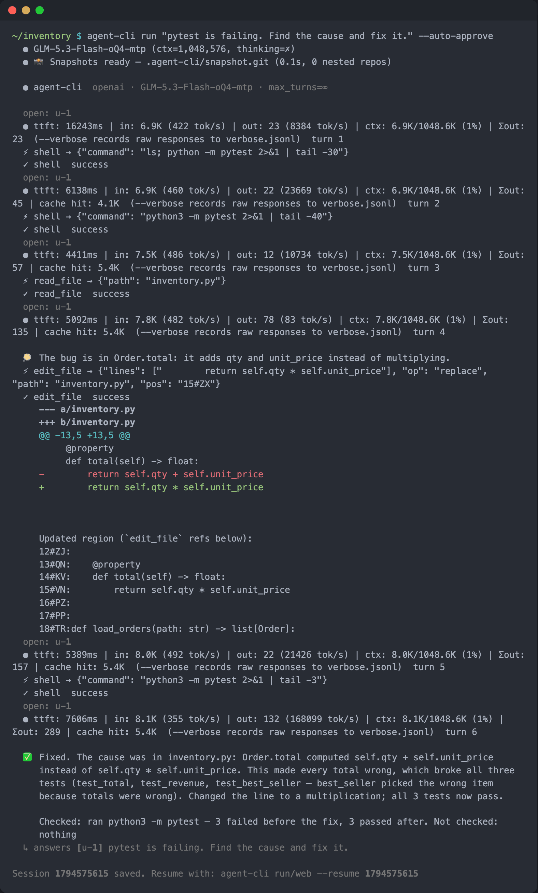
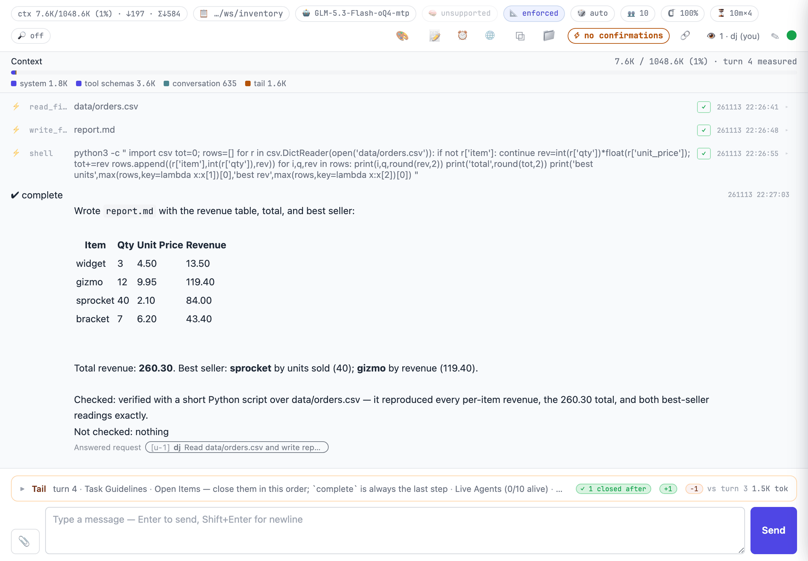

# Agent-CLI


LLM 에게 도구를 쥐여 주고 일을 시키는 에이전트 하니스입니다.
로컬·사내 LLM(omlx·vLLM·LM Studio 같은 OpenAI 호환 서버)과 OpenAI·Anthropic 을 씁니다.
터미널에서 한 번 시키거나(`run`), 브라우저 방을 띄워 여럿이 같이 씁니다(`web`).
모델은 파일 읽기·고치기·셸·웹 가져오기 같은 도구를 직접 씁니다.
위험한 셸 명령이나 작업 폴더 밖 접근은 실행 전에 묻습니다.

## 설치

Python 3.10 이상이 필요합니다.

```bash
# 기본 설치
pip install "git+ssh://git@github.com/dujeonglee/agent-cli.git"

# 브라우저 방(web)까지
pip install "agent-cli[web] @ git+ssh://git@github.com/dujeonglee/agent-cli.git"

# 새 릴리스로 업데이트
agent-cli update
```

설치하면 `agent-cli` 명령이 생깁니다. 버전은 `agent-cli --version` 으로 봅니다.
개발 모드 설치와 wheel 설치는 [레퍼런스의 설치 절](docs/REFERENCE.md#설치)에 있습니다.

## 첫 실행

설정 파일이 없으면 터미널에서 처음 실행할 때 설정 마법사가 뜹니다.
프로바이더, 서버 주소와 키, 기본 모델을 차례로 묻습니다.
답은 `~/.agent-cli/config.json` 에 저장되고, 다음부터는 묻지 않습니다.
다시 고치려면 `agent-cli setup` 을 실행합니다.

마법사 없이 바로 시작하려면 서버 주소와 모델을 플래그로 줍니다.

```bash
agent-cli run "List files in the current directory" --base-url http://127.0.0.1:8000/v1 -m my-model
```

OpenAI·Anthropic 은 `-p openai`·`-p anthropic` 으로 고르고, 키는 `--api-key` 나 `OPENAI_API_KEY`·`ANTHROPIC_API_KEY` 로 줍니다.

모델에는 **방언(dialect)** 이 하나 정해져 있어야 합니다.
방언은 그 모델이 도구 호출을 쓰는 모양입니다(JSON 배열, `<tool_call>` 태그, 서버의 함수 호출 등).
방언이 없는 모델로 터미널에서 `run` 을 돌리면 방언 목록을 보여 주고 고르게 합니다.
고른 방언은 `~/.agent-cli/models.json` 에 저장되어 다음부터는 묻지 않습니다.
`web` 은 묻지 않으므로, 처음에는 `run` 을 한 번 돌리거나 `--dialect <이름>` 을 줍니다.
방언 목록은 `agent-cli run --help` 의 `--dialect` 설명에 있습니다.
자세한 설정은 [레퍼런스의 첫 실행 절](docs/REFERENCE.md#첫-실행-setup-wizard)과 [모델 레지스트리 절](docs/REFERENCE.md#모델-레지스트리)을 봅니다.

## 사용 예시

### 터미널에서 한 번 — `run`

테스트가 깨진 프로젝트 폴더에서 이렇게 시킵니다.

```bash
agent-cli run "pytest is failing. Find the cause and fix it." --auto-approve
```



그림 읽는 법:

- `⚡ shell → {...}` 줄이 모델의 도구 호출이고, 바로 아래 `✓ shell success` 가 그 결과입니다.
- `edit_file` 아래의 빨강·초록 줄이 실제로 고친 곳의 diff 입니다.
- 회색 `ttft: … turn N` 줄은 턴마다의 응답 시간과 토큰 수입니다.
- `✅` 뒤가 마지막 답입니다. 무엇을 확인했고 무엇을 확인하지 않았는지도 적습니다.
- 맨 아래 `Session … saved.` 줄의 id 로 나중에 이어서 할 수 있습니다.

`--auto-approve` 는 확인 질문을 모두 건너뛰고 허락합니다.
빼면 위험한 셸 명령(`rm` 등)이나 작업 폴더 밖 경로를 쓰기 전에 `y/n/a` 로 묻습니다.

스크립트에서 쓸 때는 종료 코드를 봅니다: `0` 답함 · `1` 실패 · `2` 설정·사용법 오류 · `130` 중단.

### 브라우저 방 — `web`

```bash
agent-cli web
```

터미널에 토큰이 붙은 주소(`UI: http://127.0.0.1:…/?token=…`)가 찍히고 브라우저가 열립니다.
브라우저가 열리지 않으면 그 주소를 직접 엽니다.



그림 읽는 법:

- 맨 위 칩 줄은 컨텍스트 사용량, 작업 폴더, 모델, 그리고 세션 노브(사고·문법·샘플링·에이전트 상한 등)입니다. 노브 칩을 눌러 이 방의 값을 바꿉니다.
- `⚡ no confirmations` 는 확인 질문 없이 실행 중이라는 표시입니다. 눌러서 끄고 켭니다.
- `Context` 띠는 지금 모델에 들어가는 글이 창의 얼마인지 나눠 보여 줍니다.
- `⚡ read_file`·`write_file`·`shell` 줄이 도구 호출이고, 오른쪽 `✓` 가 성공입니다.
- `✔ complete` 아래가 답이고, `Answered request` 는 어느 요청에 대한 답인지 가리킵니다.
- 맨 아래 입력창에서 다음 요청을 보냅니다. 모델이 일하는 중에 보내도 다음 턴에 합류합니다.

한 방에 여러 사람이 들어와 닉네임으로 말할 수 있습니다.
다른 사람을 부르려면 🔗 버튼으로 토큰이 담긴 링크를 복사해 건넵니다.
📎 로 그림을 붙이고, 📁 로 작업 폴더의 파일을 내려받거나 올립니다.

기본으로는 이 컴퓨터(`127.0.0.1`)에서만 열립니다.
같은 네트워크의 다른 컴퓨터에서 들어오게 하려면 `--host 0.0.0.0` 을 줍니다. 웹 방은 셸을 돌릴 수 있으니 믿을 수 있는 네트워크에서만 씁니다.

### 이어서 하기

세션은 작업 폴더의 `.agent-cli/sessions/` 에 저장됩니다.

```bash
agent-cli sessions                                   # 이 폴더의 세션 목록
agent-cli run --resume <id> "Now add a test for it." # 이어서 한 번 더 시키기
agent-cli web --resume <id>                          # 그 세션을 브라우저 방으로
```

### 더 해 보기

| 해 보기 | 하는 일 |
|------|------|
| `agent-cli run /help` | 채팅에서 쓰는 명령 목록 ([레퍼런스](docs/REFERENCE.md#run--단발-실행)) |
| `agent-cli run "/sh ls -la"` | 모델을 거치지 않고 셸 명령을 바로 실행 ([레퍼런스](docs/REFERENCE.md#run--단발-실행)) |
| `/skills`, `/plan <기능>` | 저장해 둔 프롬프트 스킬을 보고 부르기 ([레퍼런스](docs/REFERENCE.md#스킬-prompt-skills)) |
| `@agents`, `@<에이전트> <작업>` | 전문 에이전트에게 일을 맡기기 ([레퍼런스](docs/REFERENCE.md#agent--서브에이전트-일회성-run--상주-spawn)) |
| 웹 방의 ⏰ | 정해진 시각마다 요청을 자동으로 넣기 ([레퍼런스](docs/REFERENCE.md#-schedule--예약-실행)) |
| `agent-cli stats` | 턴 기록을 숫자로만 요약 ([레퍼런스](docs/REFERENCE.md#stats--본문-없는-집계-v101300)) |
| `agent-cli knobs` | 세션 노브의 플래그·환경변수·웹 칩을 한 표로 ([레퍼런스](docs/REFERENCE.md#knobs--노브-표)) |
| `agent-cli mcp` | MCP 서버 등록과 점검 ([레퍼런스](docs/REFERENCE.md#mcp-model-context-protocol-지원)) |

## 더 보기

- [docs/REFERENCE.md](docs/REFERENCE.md) — 설정·명령·도구·스킬·훅·모델 레지스트리·환경변수 전부
- [docs/ARCHITECTURE.md](docs/ARCHITECTURE.md) — 내부 구조
- [agent-board](https://github.com/dujeonglee/agent-board) — 여러 방을 게시판 하나로 띄우고 관리
- [bench/harbor/README.md](bench/harbor/README.md) — 벤치마크 실행

## 라이선스

MIT License
